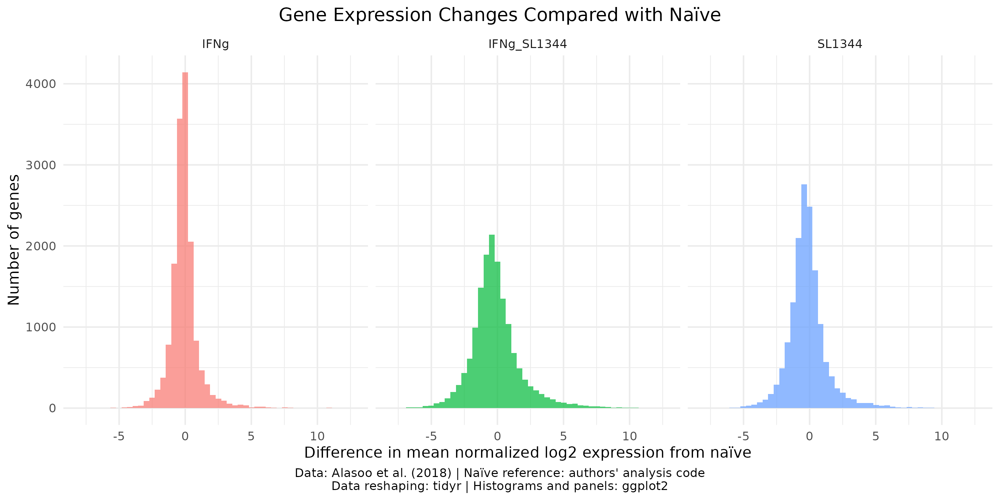
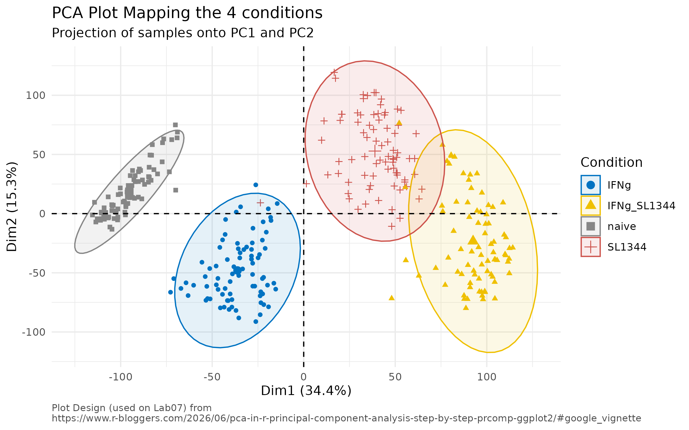
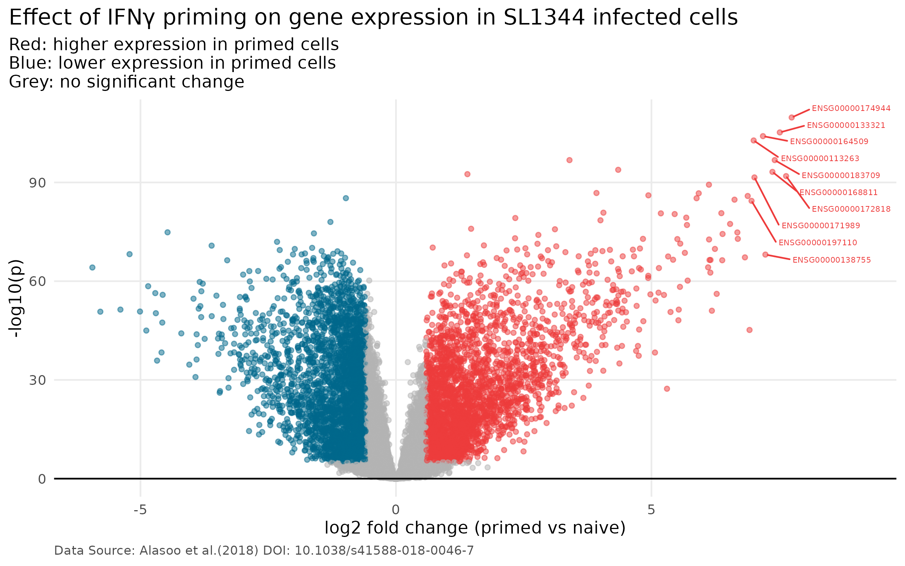

## Introduction

**Reference:** Alasoo et al. (2018). Shared genetic effects on chromatin and gene expression indicate a role for enhancer priming in immune response. *Nature Genetics*, *50*(3), 424–431.

::::: columns
::: {.column width="55%"}
**Dataset & Cohort**

-   **Model:** Human macrophages differentiated from iPSCs (HipSci collection).
-   **Cohort:** **84** healthy, unrelated donors.
-   **Dimensions:** **336** total samples (4 per donor) across **35,033** genes.
-   **Files:** Raw count matrix, CQN-normalized matrix, and sample metadata.
:::

::: {.column width="45%"}
**Experimental Conditions**

-   **`naive`:** Untreated baseline
-   **`IFNg`:** IFNγ immune priming (18h)
-   **`SL1344`:** *Salmonella* infection (5h)
-   **`IFNg_SL1344`:** Priming + infection

**Project Aim**

-   Clean the dataset, explore global expression patterns, and identify differentially expressed genes across treatments.
:::
:::::

::: notes
We analyzed the RNA-seq dataset from Alasoo et al. (2018), which uses iPSC-derived macrophages from 84 healthy donors exposed to four conditions: untreated, IFN-gamma priming, Salmonella infection, and both combined. Starting from 336 samples and 35,033 genes, our goal is to clean the data, assess global variance, and identify key differentially expressed genes driving the immune response.
:::

## Clean data

**Libraries** : `tidyverse`

::::: columns
::: {.column width="50%"}
### **Sample** **MetaData**

**Keep relevant and reliable sample metadata**

-   `select()` – Removed irrelevant columns for analysis

-   `filter()` – Removed rows with entirely missing purity information and donors that had unreliable data

-   `rename()` - Renamed columns with unclear or inconsistent names

**Cleaned Data**

```{r}
library("tidyverse")
sample_meta <- read_tsv("../data/_raw/RNA_sample_metadata.txt.gz", show_col_types = FALSE)

clean_sample_meta <- sample_meta |>
  select(c("sample_id","donor","condition","replicate","condition_name"              ,"SL1344","IFNg","received_as","mean_purity","max_purity","sex",           ,"rna_concentration","purity_bins")) |>
  filter(!if_all(contains("purity"), is.na),
          !received_as == "alive/frozen") |>
  rename( SL1344_infection = SL1344,
          IFNg_status = IFNg) 

clean_sample_meta |>
  slice_sample(n = 8)
```
:::

::: {.column width="50%"}
### **Normalised Count Data**

**Filter low count genes**

```{dot}
//| fig-width: 6
//| fig-height: 5
//| fig-align: center
digraph G {
  bgcolor="transparent";
  ranksep=0.45;
  node [shape=box, style=filled, fixedsize=true, width=3.2, height=1.0,
        fontname="Helvetica", fontsize=16, penwidth=1.5];
  edge [color="#808080", arrowsize=0.8];

  A [label=<<b>Raw counts data</b>>,
     fillcolor="#416788", color="#2F506B", fontcolor="white"];

  B [label=<<b>Gene filtering</b><br/>Only genes with ≥ 10 counts<br/>in ≥ 80 samples were retained>,
     fillcolor="#EAF2F8", color="#416788", fontcolor="#243B53"];
    
  C [label=<<b>Normalised count data</b>>,
     fillcolor="#416788", color="#2F506B", fontcolor="white"];

  D [label=<<b>Gene selection</b><br/>semi_join() retained genes<br/>present in both datasets>,
     fillcolor="#DCEAF5", color="#416788", fontcolor="#243B53"];

  E [label=<<b>Cleaned normalised</b><br/><b>counts data</b>>,
     fillcolor="#416788", color="#2F506B", fontcolor="white"];

  A -> B -> D;
  C -> D;
  D -> E;
}
```
:::
:::::

::: notes
**Raw Counts Data**

-   **Function:** `filter()`

Genes with consistently low read counts were removed to reduce their influence on the analysis: only genes with at least **10 counts** in a minimum of **80 samples** were retained

-   **Function**: `semi_join()`

Removed the same genes we filtered in the raw counts, from the normalised data.

**Why use this function?**

It keeps only the rows that appear in the two data sets, without adding any columns from it.
:::

## Augment Data

## Results

### Gene expression differences from naïve

{width="76%" fig-align="center"}

-   All three distributions peaked near zero.
-   The IFNg-only condition had the narrowest peak. The combined IFNg and SL1344 condition showed the widest spread around its peak.

## Discussion

## Exploratory Analysis: PCA

::::: columns
::: {.column width="60%"}
We used `factoextra::fviz_pca_ind()` to automatically map axis variance and add 95% confidence ellipses.

{width="100%"}
:::

::: {.column width="40%"}
**Libraries Used**

-   `tidyverse`: reshaped data (`pivot_wider()`)
-   `stats`: computed PCA (`prcomp()`)
-   `factoextra` & `ggplot2`: plotted samples & 95% ellipses

**Plot Interpretation**

-   **4 distinct clusters** matching the experimental conditions.
-   **PC1 (34.4%)**: separates *Salmonella*-infected (`SL1344`) from uninfected samples.
-   **PC2 (15.3%)**: separates IFNγ-primed from unstimulated cells.
-   Biological treatment is the main driver of variation.
:::
:::::

## Differential Expression analysis: linear model

**Libraries Used :** `tidyverse` , `broom`

::::: columns
::: {.column width="50%" style="font-size:1em"}
### **Set up**

``` r
compare_infected <- merged_data |>
  filter(SL1344_infection == "infected") |>
  mutate(IFNg_status = factor(IFNg_status, 
                              levels = c("naive", "primed")))
```

-   Only **infected samples** were analysed

-   Compared *naive* vs *primed* cells

### Model per gene

``` r
compare_infected_nested <- compare_infected_nested |> 
  mutate(model_object = map(.x = data,
                            .f = ~lm(formula = log2_counts ~ IFNg_status,
                            data = .x)))
```

-   `mutate()` + `map()`, applying `lm()` to every gene : log2_counts \~ IFNg_status

``` r
compare_infected_nested <- compare_infected_nested |> 
  mutate(model_object_tidy = map(.x = model_object,
                                 .f = ~ tidy(.x, 
                                             conf.int = TRUE, 
                                             conf.level = 0.9)))
```

-   `tidy()` turns each model into a table of estimates, p-values and confidence intervals
:::

::: {.column width="50%"}
```{dot}
//| fig-width: 6
//| fig-height: 5.5
//| fig-align: center
digraph G {
  bgcolor="transparent";
  ranksep=0.4;
  nodesep=0.25;
  node [shape=box, style=filled, fixedsize=true, width=2.0, height=0.9,
        fontname="Helvetica", fontsize=14, penwidth=1.5];
  edge [color="#808080", arrowsize=0.8, fontname="Helvetica", fontsize=12];

  A [label=<<b>Estimates</b><br/>p-value and log2FC per gene>,
     fillcolor="#416788", color="#2F506B", fontcolor="white", width=4.5];

  B [label=<<b>Multiple testing correction</b><br/>p.adjust() gives q-value>,
     fillcolor="#EAF2F8", color="#416788", fontcolor="#243B53", width=4.5];

  C [label=<<b>Classify each gene</b><br/> case_when() function>,
     fillcolor="#DCEAF5", color="#416788", fontcolor="#243B53", width=4.5];

  U [label=<<b>up</b><br/>q &lt; 0.05<br/>log2FC &gt; 1>,
     fillcolor="#EE5C42", color="#CD4F39", fontcolor="white"];

  NS [label=<<b>not significant</b><br/>q ≥ 0.05>,
     fillcolor="#B3B3B3", color="#8C8C8C", fontcolor="#243B53"];

  D [label=<<b>down</b><br/>q &lt; 0.05<br/>log2FC &lt; -1>,
     fillcolor="#00688B", color="#004B63", fontcolor="white"];

  A -> B -> C;
  C -> D;
  C -> NS;
  C -> U;

  {rank=same; D; NS; U;}
}
```
:::
:::::

::: notes
To be able to see the differences in gene expressions in infected cells, we kept only the infected samples. Within these samples, the two groups to compare are the naive and the primed cells. We then converted IFNg_status into a factor with "naive" as the first level (set to be the reference).

Fit a linear model for every gene. We use `mutate()` together with `map()`, which applies the same function to each element of data column. The function is `lm()` with the formula "log2_counts \~ IFNg_status".

For each gene, the model estimates the mean expression in naive cells (the intercept) and the difference between primed and naive cells. Since the values are on a log2 scale, this difference is the log2 fold change.

We used `tidy()` from broom library to convert each model into a table of estimates, p-values and confidence intervals.

From the unnested results we kept only the relevant rows and the columns needed for further analysis.

We do a multiple testing correction, ajusting the p.values using `p.adjust()`, which gives the q.value. Finally, we used `case_when()` to classify each gene in a new column: a gene is "up" if q.value \< 0.05 and the log2 fold change is above 0.59 (at least twofold higher in primed cells); "down" if q.value \< 0.05 and the log2 fold change is below -0.59 (at least twofold lower in primed cells), and "not significant" otherwise (q.value \>= 0.05) .
:::

## **Differential Expression Analysis: Volcano Plot**

:::::: columns
::: {.column width="60%"}
{fig-align="left"}
:::

:::: columns
::: {.column width="40%"}
**Libraries Used**

-   `tidyverse`: selected the top 10 genes (`slice_max()`) and plotted all genes (`ggplot ()`)
-   `ggrepel`: labelled the top 10 genes (`geom_text_repel()`)

**Plot Interpretation**

-   About **38% of the genes** analysed (5,811 of 15,448) change significantly between primed and naive infected cells.

-   The majority of the genes, about **9,637**, don't show a significant change.

-   The split is almost even: **2,876** genes are **up** and **2,935** are **down.**

-   No down-regulated gene is among the 10 largest fold changes. All 10 are up-regulated, with log2FC of about 7 to 8.
:::
::::
::::::
